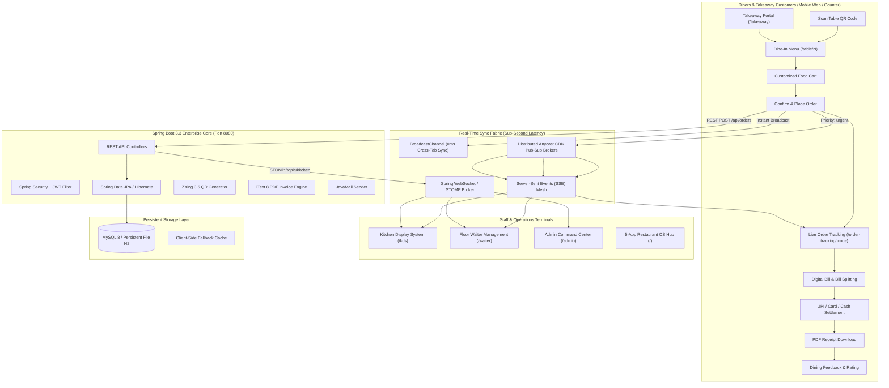
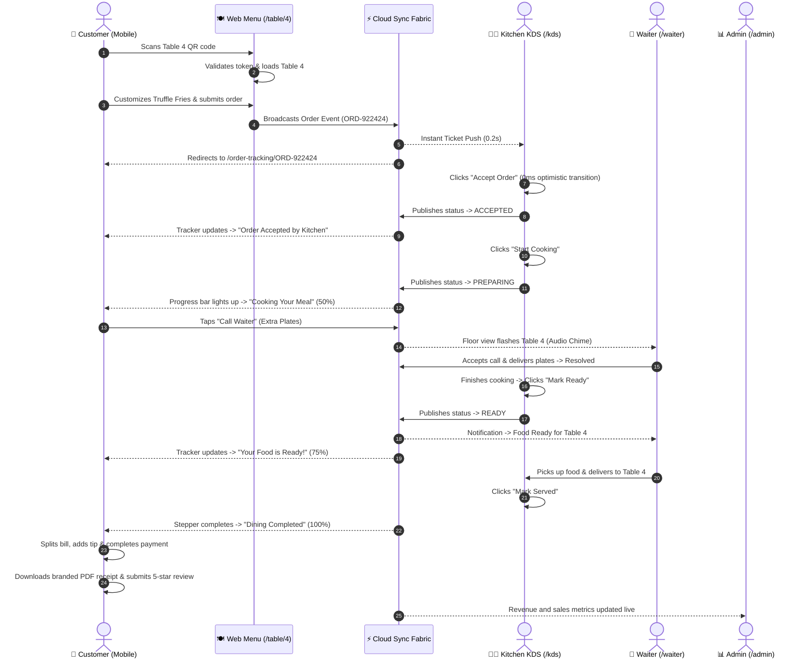

# ☕ Lowkey Cafe - Next-Gen Restaurant Operating System & Contactless QR Dining

[](https://reactjs.org/)
[](https://www.typescriptlang.org/)
[](https://vitejs.dev/)
[](https://tailwindcss.com/)
[](https://spring.io/projects/spring-boot)
[](https://www.oracle.com/java/)
[](https://lowkey-cafe-three.vercel.app)
[](LICENSE)

> **Live Production Portal:** [https://lowkey-cafe-three.vercel.app](https://lowkey-cafe-three.vercel.app)  
> **Tagline:** *"Your Cafe. Your Control. Everything in One Place."*

Lowkey Cafe is an enterprise-grade, full-stack **Restaurant Operating System (Restaurant OS)** designed for high-volume modern hospitality. It unifies the entire dining lifecycle—from frictionless table QR scanning and live food customization to a live Kitchen Display System (KDS), waiter floor dispatch, split billing, digital payments, PDF receipt generation, and real-time administrative analytics.

Engineered with a **resilient hybrid architecture**, Lowkey Cafe functions both as a traditional Spring Boot + MySQL / WebSocket application and as an ultra-fast, serverless-ready progressive web platform powered by distributed cloud pub-sub synchronization.

---

## 📑 Table of Contents

- [1. System Architecture](#1-system-architecture)
- [2. Core Application Modules](#2-core-application-modules)
  - [A. Central Restaurant OS Portal (`/`)](#a-central-restaurant-os-portal-)
  - [B. Contactless Table QR Dining (`/table/:tableNumber`)](#b-contactless-table-qr-dining-tabletablenumber)
  - [C. Counter & Takeaway Console (`/takeaway`)](#c-counter--takeaway-console-takeaway)
  - [D. Live Kitchen Display System (KDS) (`/kds`)](#d-live-kitchen-display-system-kds-kds)
  - [E. Waiter Floor & Guest Dispatch (`/waiter`)](#e-waiter-floor--guest-dispatch-waiter)
  - [F. Restaurant Admin & Operations Hub (`/admin`)](#f-restaurant-admin--operations-hub-admin)
  - [G. Live Order Tracking & Split Billing (`/order-tracking/:orderCode`)](#g-live-order-tracking--split-billing-order-trackingordercode)
- [3. Sub-Second Cloud Synchronization Engine](#3-sub-second-cloud-synchronization-engine)
- [4. Complete End-to-End Workflow](#4-complete-end-to-end-workflow)
- [5. Technology Stack](#5-technology-stack)
- [6. Database Architecture & Relational Schema](#6-database-architecture--relational-schema)
- [7. REST API & Real-Time Protocol Documentation](#7-rest-api--real-time-protocol-documentation)
- [8. Security & Role-Based Access Control (RBAC)](#8-security--role-based-access-control-rbac)
- [9. Demo Credentials](#9-demo-credentials)
- [10. Setup and Installation Instructions](#10-setup-and-installation-instructions)
- [11. Testing & Verification Guide](#11-testing--verification-guide)

---

## 1. System Architecture



---

## 2. Core Application Modules

### A. Central Restaurant OS Portal (`/`)
- **Futuristic Dark-Mode Identity**: Deep black background (`#090909`), subtle golden yellow accents (`#FFD000`), dark charcoal cards (`#171717`), and Lucide icons.
- **5-App Navigation Gateway**: Single-screen access point connecting staff and diners to their respective applications:
  1. 🥡 **Takeaway Console**: Customer and counter takeaway ordering (`/takeaway`).
  2. 🔐 **Staff Login**: Secure login for waiters, kitchen cooks, and managers (`/login`).
  3. 🍳 **Kitchen Display (KDS)**: Live kitchen ticket preparation screen (`/kds`).
  4. 🔔 **Floor Waiter**: Table dining tracker, waiter call alerts, and cash bill settlement (`/waiter`).
  5. 📊 **Owner Admin**: Central restaurant management dashboard, analytics, and QR printing (`/admin`).
- **Responsive Viewport Design**: Fits on a single desktop/laptop screen without scrolling; automatically transforms to a clean vertical stack on mobile devices.

### B. Contactless Table QR Dining (`/table/:tableNumber`)
- **Automatic Table Recognition**: Scans table QR sticker or navigates via URL parameter (`/table/5?token=...`). Secure token validation automatically assigns the table without requiring user signup.
- **Categorized Digital Menu**: 8 curated categories: *Starters*, *Main Course*, *Fast Food*, *Pizza*, *Burgers*, *Beverages*, *Desserts*, and *Special Offers*.
- **Granular Customization Engine**: Select portion sizes (Full / Regular / 12" Large), customize spice levels (Mild, Medium, Hot, Extra Hot), configure paid add-ons/sauces, enter ingredient exclusions ("No Onions", "No Mayo"), and add chef notes.
- **Dynamic Promo Codes**: Apply discount coupons (`WELCOME10`, `LOWKEY20`, `TASTY50`) with instant validation and subtotal deduction.
- **Customer Loyalty Points**: Check balance by phone number and redeem accrued points directly at checkout (1 point = ₹1 discount).
- **Interactive Call Waiter**: Quick-action modal with structured request types: *Need Water*, *Extra Cutlery*, *Menu Recommendation*, *Clean Table*, or *Assistance*. Includes anti-spam rate limiting.

### C. Counter & Takeaway Console (`/takeaway`)
- **Dedicated Takeaway Mode**: Formatted specifically for takeaway diners and counter operators.
- **Waived Service Charge**: 5% restaurant service charge is automatically waived (₹0.00) for all takeaway orders.
- **Diner Contact & Pickup Details**: Captures customer name, phone number, and special pickup packing notes.
- **Quick Dining Switcher**: One-click toggle between Dine-In and Takeaway modes inside the cart drawer.

### D. Live Kitchen Display System (KDS) (`/kds`)
- **Touchscreen Kitchen Interface**: High-contrast dark UI optimized for kitchen wall monitors, tablets, and heat-resistant displays.
- **Multi-Station Order Routing**:
  - Espresso Bar / Beverage Station
  - Grill Station / Hot Mains
  - Bakery & Dessert Station
  - Cold Prep & Starters
  - Dedicated **Takeaway** Tab with live counter badge.
- **Dynamic Ticket Cards**: Table number, order code, elapsed timer, delayed order highlight (turns pulsing red when prep time exceeds 15 minutes), spice level badges, customizations, and ingredient exclusions.
- **0ms Optimistic UI Transitions**: Instant action button transitions (`Accept Order` &rarr; `Start Cooking` &rarr; `Mark Ready` &rarr; `Mark Served`) with zero button freezing or network lag.
- **Clean Kitchen Architecture**: Live "Clear All" maintenance tool and clean initial zero-ticket state.

### E. Waiter Floor & Guest Dispatch (`/waiter`)
- **Interactive Restaurant Floor View**: 10 tables organized by dining zone (*Indoor Lounge*, *Patio Garden*, *Rooftop Terrace*) with real-time color-coded states:
  - `AVAILABLE` (Green): Clean and ready for guests.
  - `OCCUPIED` (Blue): Guests seated with active dining.
  - `PREPARING` (Orange): Kitchen actively cooking order.
  - `FOOD_READY` (Pulsing Emerald): Dish plated and waiting for server pickup.
  - `ASSISTANCE_REQUESTED` (Pulsing Rose): Diner tapped "Call Waiter".
  - `BILLING_REQUESTED` (Purple): Diner requested bill / cash collection.
- **Guest Assistance Dispatch Feed**: Incoming waiter calls displaying table number, request type, timestamp, and quick **Accept** / **Resolve** controls.
- **Table Settlement & Freeing**: Collect cash payments directly at table and reset table to `AVAILABLE` with 1 click.

### F. Restaurant Admin & Operations Hub (`/admin`)
- **Executive KPI Dashboard**: Live revenue, occupied tables ratio, active kitchen tickets, ready-to-serve alerts, average guest rating, and weekly/monthly trends.
- **Table & QR Management**: Add/edit tables, configure seating capacities, generate secure tokenized QR codes, download high-res PNG badges, and print table tent cards.
- **Menu Catalog Management**: Add/edit dishes, upload image URLs, configure prices, toggle veg/non-veg, set spice levels, allergen tags, and 1-click 86/sold-out toggle.
- **Staff Access Control**: Manage accounts with Role-Based Access Control (`ROLE_ADMIN`, `ROLE_KITCHEN_STAFF`, `ROLE_WAITER`).
- **Cafe Settings**: Dynamic Wi-Fi credentials, GST tax percentage, service charge percentage, currency formatting, and operating hours.

### G. Live Order Tracking & Split Billing (`/order-tracking/:orderCode`)
- **Live Animated Stepper**: Real-time animated progress bar reflecting kitchen execution:
  - **Step 1: Order Received** &rarr; Ticket sent to kitchen.
  - **Step 2: Order Accepted** &rarr; Kitchen acknowledged ticket.
  - **Step 3: Preparing Food** &rarr; Chef actively cooking (50% progress).
  - **Step 4: Food Ready / Pickup** &rarr; Plated for server delivery or packed at counter (75% progress).
  - **Step 5: Served / Completed** &rarr; Delivered to table or handed to customer (100% full progress line).
- **Flexible Bill Splitting**: Split bill equally among N diners or allocate custom split amounts.
- **Gratuity & Tips**: Add server tips (5%, 10%, 15%, or custom amount).
- **Payment Gateway Simulation**: UPI QR code generation, credit/debit card simulator, and cash collection requests.
- **Downloadable PDF Invoices**: Client-side & server-side generated branded receipts with itemized breakdown, tax audit, and QR validation.
- **Dining Feedback**: 4-metric star rating (Food, Service, Ambiance, Value) with optional written comments.

---

## 3. Sub-Second Cloud Synchronization Engine

To guarantee zero ordering delays across real mobile phones (iOS Safari, Android Chrome) and staff desktop screens without requiring a dedicated persistent server, Lowkey Cafe implements a multi-layer real-time sync architecture:

1. **High-Speed CDN SSE Pub-Sub**: Server-Sent Events (SSE) stream updates through Anycast and European community brokers (`ntfy.adminforge.de`, `ntfy.envs.net`, `ntfy.tedomum.fr`) with sub-second delivery (<300ms).
2. **Urgent Delivery Headers**: Cloud publishes dispatch with `Priority: urgent`, `X-Priority: 5`, and `X-Tags: fast_sync`, bypassing broker batching queues for immediate packet flushing.
3. **Cross-Tab BroadcastChannel**: `lowkey_cafe_sync_v8` synchronizes tabs and windows on the same device in 0ms with zero network overhead.
4. **Mobile Tab Sleep Prevention**: Listens to `visibilitychange`, `window.focus`, and `online` events across all screens. The millisecond a customer or waiter unlocks their phone or switches back to the browser tab, an instant forced synchronization occurs.
5. **Optimistic UI Execution**: KDS buttons update their local state immediately in 0ms upon tap before network confirmation arrives, eliminating chef UI freezing.
6. **Robust Fallback Polling**: A 3.5-second background safety heartbeat guarantees that table states and tickets stay synchronized even under unstable mobile 4G/5G connections.

---

## 4. Complete End-to-End Workflow



---

## 5. Technology Stack

| Layer | Technologies & Libraries | Purpose |
|---|---|---|
| **Frontend Framework** | React 18.3, TypeScript 5.5 | Type-safe, component-driven reactive architecture |
| **Build Tool & Bundler** | Vite 5.4 | Ultra-fast HMR, optimized tree-shaking, production chunking |
| **Styling & Icons** | Tailwind CSS 3.4, Lucide React | Modern dark-mode utility classes, responsive typography, scalable SVGs |
| **Client Routing** | React Router DOM 6.26 | Declarative client-side routing with parameter guards |
| **Real-Time Pub-Sub** | EventSource (SSE), BroadcastChannel API, StompJS, SockJS | Distributed sub-second cloud synchronization & cross-tab messaging |
| **Networking & HTTP** | Axios 1.7 | REST API client with JWT authorization interceptors and timeout handling |
| **Client PDF Engine** | jsPDF 2.5, html2canvas 1.4 | High-fidelity client-side PDF invoice generation |
| **UI Effects** | Canvas-Confetti | Rewarding visual confetti burst upon bill payment completion |
| **Backend Core** | Java 21 LTS, Spring Boot 3.3.4 | Enterprise REST API, dependency injection, validation |
| **Security & Auth** | Spring Security 6, JJWT (HMAC-SHA256), BCrypt | Role-Based Access Control (RBAC), token authorization |
| **Database & ORM** | MySQL 8 / Persistent File H2, Hibernate 6, Spring Data JPA | Relational persistence, connection pooling, transactional integrity |
| **Backend PDF & QR** | iText 8.0.4, Google ZXing 3.5.3 | Server-side invoice generation and barcode/QR rendering |
| **Hosting & Edge** | Vercel (Frontend & Serverless Edge) | Global CDN distribution, automated CI/CD pipeline |

---

## 6. Database Architecture & Relational Schema

The relational schema implements 32 tables with strict primary keys, foreign key constraints, and performance indexes:

```
├── Identity & Access
│   ├── users                      (Staff & diner credentials, email, password hash)
│   ├── roles                      (ROLE_ADMIN, ROLE_KITCHEN_STAFF, ROLE_WAITER, ROLE_CUSTOMER)
│   └── user_roles                 (Many-to-many RBAC mappings)
├── Restaurant Infrastructure
│   ├── restaurants                (Brand name, address, tax registration, currency)
│   ├── restaurant_settings        (Wi-Fi credentials, tax %, service charge %, loyalty ratio)
│   ├── restaurant_tables          (Table numbers, zones, seating capacity, live status)
│   ├── table_qr_codes             (Access tokens, target URLs, Base64 QR blobs)
│   ├── kitchen_stations           (Station 1: Espresso Bar, Station 2: Grill, etc.)
│   └── station_food_items         (Routing mappings from dishes to stations)
├── Menu & Catalog
│   ├── food_categories            (Categories: Starters, Mains, Fast Food, Pizza, etc.)
│   ├── food_items                 (Dishes, base prices, prep times, allergens, spice levels)
│   ├── food_customizations        (Grouping: Crust, Size, Add-ons, Extra Toppings)
│   └── customization_options      (Individual add-on names with extra pricing)
├── Promotions & Loyalty
│   ├── coupons                    (Coupon codes: WELCOME10, discount values, expiry dates)
│   ├── customer_profiles          (Diner phone numbers, names, visit history)
│   ├── loyalty_points             (Active point balances, lifetime earnings)
│   └── loyalty_transactions       (Points credit and debit logs)
├── Orders & Kitchen Execution
│   ├── orders                     (Master tickets: subtotal, tax, grand total, status, timing)
│   ├── order_items                (Line items, portion, spice, ingredient exclusions, notes)
│   ├── order_item_customizations  (Selected paid add-ons per item)
│   └── kitchen_order_tracking     (Preparation elapsed times, delay audits)
├── Waiter Floor Dispatch
│   ├── waiter_requests            (Guest calls: water, cutlery, bill, assistance, status)
│   └── staff_assignments          (Waiter-to-table shift allocation)
├── Billing & Payments
│   ├── bills                      (Invoices, tax breakdown, service charge, final amount)
│   ├── bill_items                 (Snapshot of billed food items)
│   ├── bill_splits                (Equal and custom diner split records)
│   ├── tips                       (Server gratuity logs)
│   ├── payments                   (Payment method: UPI, Card, Cash, gateway refs)
│   ├── payment_transactions       (Signature audits and gateway payload logs)
│   └── receipts                   (Receipt metadata, PDF hashes, email dispatch logs)
└── Feedback & Auditing
    ├── reviews                    (Ratings 1-5 for food, service, clean, ambiance, comments)
    ├── notifications              (Role-targeted operational alerts)
    └── audit_logs                 (Administrative actions, menu changes, voids)
```

*The complete, production-ready MySQL DDL script is located at `backend/src/main/resources/schema-mysql.sql`.*

---

## 7. REST API & Real-Time Protocol Documentation

### Public Customer Endpoints
- `GET /api/tables/{tableNumber}`: Fetch table metadata and floor zone.
- `GET /api/tables/{tableNumber}/validate-token?token=...`: Verify table QR token integrity.
- `GET /api/menu/categories`: List active food categories.
- `GET /api/menu/items`: List all available food items with customization groups.
- `GET /api/menu/special-offers`: List promotional combo deals.
- `POST /api/orders`: Place a new Dine-In or Takeaway order.
- `GET /api/orders/{orderCode}`: Fetch live tracking status and items for an order.
- `POST /api/waiter/call`: Dispatch a waiter call with table number and request type.
- `GET /api/billing/order/{orderId}`: Retrieve itemized digital bill.
- `POST /api/billing/{billId}/tip`: Apply server gratuity tip.
- `POST /api/billing/{billId}/split`: Calculate equal or custom bill splits.
- `POST /api/billing/pay/initiate`: Initialize payment session (UPI, Card, Cash).
- `POST /api/billing/pay/verify`: Validate payment signature and mark bill `PAID`.
- `GET /api/billing/{billId}/receipt/pdf`: Stream official branded PDF receipt.
- `POST /api/billing/{billId}/receipt/email`: Send PDF invoice to customer's email.
- `GET /api/loyalty/balance?phone=...`: Check available reward points balance.
- `POST /api/loyalty/redeem`: Redeem loyalty points for checkout deduction.
- `POST /api/reviews`: Submit 4-metric dining review and comments.
- `GET /api/settings`: Fetch restaurant branding and guest Wi-Fi details.

### Staff & Kitchen Endpoints
- `GET /api/kitchen/stations`: List active kitchen stations.
- `GET /api/kitchen/orders`: Retrieve active tickets for kitchen displays.
- `GET /api/kitchen/orders/station/{stationId}`: Filter active tickets by preparation station.
- `PATCH /api/kitchen/orders/{orderId}/status`: Advance status (`ACCEPTED`, `PREPARING`, `READY`, `SERVED`).
- `GET /api/waiter/requests`: List pending guest assistance calls.
- `PATCH /api/waiter/requests/{id}/accept`: Accept a guest call and assign waiter name.
- `PATCH /api/waiter/requests/{id}/resolve`: Resolve and dismiss a guest call.
- `PATCH /api/waiter/orders/{orderId}/served`: Mark food as served at table.
- `GET /api/waiter/floor`: Retrieve dynamic 10-table visual floor state.

### Administrative Management Endpoints (`ROLE_ADMIN`)
- `GET /api/admin/dashboard`: Live KPI summary cards (revenue, occupancy, ratings).
- `GET /api/admin/analytics`: Historical revenue trends and top-selling dishes breakdown.
- `GET /api/admin/orders`: Complete order audit log with date filtering.
- `POST /api/admin/tables`: Add physical table and generate QR code badge.
- `POST /api/admin/tables/{tableNumber}/regenerate-qr`: Rotate security token and re-render QR.
- `POST /api/admin/menu/items`: Create new menu dish with customizations.
- `PATCH /api/admin/menu/items/{id}/availability`: Toggle item in-stock / sold-out (86).
- `GET /api/admin/staff`: List registered staff accounts.
- `POST /api/admin/staff`: Create new staff user with assigned role.
- `PUT /api/admin/settings`: Update tax percentage, service charge %, Wi-Fi, and cafe info.

---

## 8. Security & Role-Based Access Control (RBAC)

- **JWT Authentication**: Passwords hashed with **BCrypt**. Authentication claims signed using HMAC-SHA256 JSON Web Tokens (`Authorization: Bearer <token>`).
- **Frictionless Customer Security**: Diners order without mandatory account creation. Requests validate against cryptographic table tokens generated during QR creation.
- **Server-Side Financial Integrity**: All bill subtotals, GST taxes (5%), service charges (5%), and coupon limits are verified on the backend before order creation.
- **Anti-Spam Throttling**: Waiter calls enforce anti-spam cooldown intervals to prevent accidental flooding.
- **Production CORS Hardening**: Restricts origin cross-sharing while permitting authenticated staff and customer web clients.

---

## 9. Demo Credentials

Quick 1-click login buttons are available directly on the `/login` screen:

| Role | Username | Password | Application Access |
|---|---|---|---|
| **Restaurant Admin** | `admin` | `admin123` | Owner Admin Portal (`/admin`), full system settings, staff & analytics |
| **Head Chef** | `kitchen` | `kitchen123` | Kitchen Display System (`/kds`), ticket management, station routing |
| **Lead Waiter** | `waiter` | `waiter123` | Waiter Floor Management (`/waiter`), guest calls, cash settlement |
| **Diner / Customer** | `customer` | `customer123` | Digital ordering (`/table/N`), order tracking, loyalty balance |

---

## 10. Setup and Installation Instructions

### Prerequisites
- **Node.js 18+** & **npm** (`node -v`, `npm -v`)
- **Java 21 JDK** (`java -version`) *(Required for Spring Boot backend)*
- **Apache Maven 3.9+** (`mvn -v`) *(Required for Spring Boot backend)*
- *(Optional)* **MySQL 8** *(If not using the default disk-persistent H2 engine)*

---

### Option A: Quick 1-Click Launch (Windows)

Double-click `run-all.bat` in the project root:
```bat
run-all.bat
```
This script concurrently starts:
1. The **Spring Boot 3.3 Backend** on `http://localhost:8080` (auto-seeding demo data).
2. The **Vite React Frontend** on `http://localhost:5173`.

---

### Option B: Manual Setup

#### 1. Start Spring Boot Backend:
```powershell
cd "D:\Projects\Lowkey Cafe\backend"
mvn spring-boot:run
```
*The backend auto-seeds the 10 tables with QR tokens, 8 categories, 23 dishes, and demo staff accounts on first initialization.*

#### 2. Start Vite React Frontend:
```powershell
cd "D:\Projects\Lowkey Cafe\frontend"
npm install
npm run dev
```

#### 3. Open Application Terminals:
- **Central Restaurant OS Portal**: [http://localhost:5173/](http://localhost:5173/)
- **Customer Table 4 Dining**: [http://localhost:5173/table/4](http://localhost:5173/table/4)
- **Counter & Takeaway Console**: [http://localhost:5173/takeaway](http://localhost:5173/takeaway)
- **Kitchen Display System (KDS)**: [http://localhost:5173/kds](http://localhost:5173/kds)
- **Floor Waiter Management**: [http://localhost:5173/waiter](http://localhost:5173/waiter)
- **Owner Admin Dashboard**: [http://localhost:5173/admin](http://localhost:5173/admin)
- **Staff Sign In**: [http://localhost:5173/login](http://localhost:5173/login)

---

## 11. Testing & Verification Guide

Follow this scenario across two side-by-side browser windows to experience the real-time ecosystem:

1. **Window 1 (Customer Mobile)**:
   - Navigate to [http://localhost:5173/table/4](http://localhost:5173/table/4).
   - Select *Artisan Burrata Margherita* pizza.
   - Choose *12" Large Sourdough (+₹149)*, add *Extra Buffalo Mozzarella (+₹79)*, set spice to *Medium*, enter "Extra crispy crust", and click **Add to Order**.
   - Open Cart Drawer, apply coupon `WELCOME10` (10% discount applies immediately).
   - Click **Confirm & Send to Kitchen**.
2. **Window 2 (Kitchen Display)**:
   - Open [http://localhost:5173/kds](http://localhost:5173/kds).
   - Ticket `TBL #4` pops in immediately with station badge and elapsed timer.
   - Click **Accept Order** &rarr; button transitions instantly (0ms) to **Start Cooking**.
   - Click **Start Cooking** &rarr; button transitions to **Mark Ready**.
3. **Window 1 (Customer Order Tracking)**:
   - Notice the animated stepper automatically advance to **Preparing Food** ("Cooking Your Meal", 50% yellow bar).
   - Click **Call Waiter** &rarr; select *Need Water* &rarr; submit.
4. **Window 2 (Floor Waiter)**:
   - Switch to [http://localhost:5173/waiter](http://localhost:5173/waiter).
   - Table 4 pulses rose with "Need Water" call alert.
   - Click **Accept** &rarr; deliver water &rarr; click **Mark Resolved**.
5. **Window 2 (Kitchen Ready & Service)**:
   - On `/kds`, click **Mark Ready** &rarr; button changes to **Mark Served**.
   - Customer screen updates to "Your Food is Ready!" (75%).
   - Click **Mark Served** &rarr; ticket clears cleanly from KDS.
6. **Window 1 (Payment & Review)**:
   - Customer screen updates to **Dining Completed** (100% full progress line).
   - Open Digital Bill &rarr; click **Split Bill** (2 diners) &rarr; select 10% gratuity tip.
   - Click **Pay Bill** &rarr; celebratory confetti triggers!
   - Click **Download PDF** to inspect generated invoice.
   - Submit a 5-star review.
7. **Window 2 (Admin Portal)**:
   - Open [http://localhost:5173/admin](http://localhost:5173/admin).
   - Live revenue, completed orders counter, and customer review scores reflect the new settlement in real time.

---

## 📄 License

This project is open-source and distributed under the **MIT License**. See the [LICENSE](LICENSE) file for complete details.

---

<div align="center">
  <sub>Crafted with passion for modern dining hospitality by the Lowkey Cafe Engineering Team.</sub>
</div>
