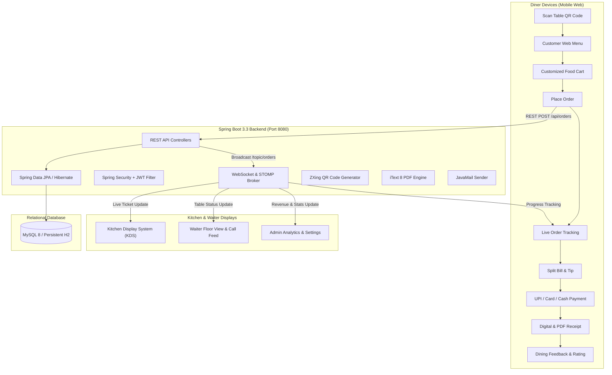

# ☕ Lowkey Cafe - Smart Restaurant Management & QR-Based Ordering System

A production-ready, full-stack Smart Restaurant Management System designed for modern dining hospitality. It digitizes the entire restaurant lifecycle—from contactless table QR scanning and live food customization to real-time Kitchen Display System (KDS) routing, waiter floor tracking, split billing, digital payments, PDF receipt generation, and owner analytics.

---

## 📑 Table of Contents

- [1. System Architecture](#1-system-architecture)
- [2. Core Application Modules](#2-core-application-modules)
  - [A. Customer Mobile Web App](#a-customer-mobile-web-app)
  - [B. Live Kitchen Display System (KDS)](#b-live-kitchen-display-system-kds)
  - [C. Waiter & Floor Staff Dashboard](#c-waiter--floor-staff-dashboard)
  - [D. Restaurant Admin Dashboard](#d-restaurant-admin-dashboard)
- [3. Complete End-to-End Workflow](#3-complete-end-to-end-workflow)
- [4. Technology Stack](#4-technology-stack)
- [5. Database Architecture & Schema](#5-database-architecture--schema)
- [6. Real-Time Synchronization (WebSocket/STOMP)](#6-real-time-synchronization-websocketstomp)
- [7. REST API Documentation](#7-rest-api-documentation)
- [8. Security & Role-Based Access Control (RBAC)](#8-security--role-based-access-control-rbac)
- [9. Demo Credentials](#9-demo-credentials)
- [10. Setup and Installation Instructions](#10-setup-and-installation-instructions)
- [11. Testing & Verification Guide](#11-testing--verification-guide)

---

## 1. System Architecture



---

## 2. Core Application Modules

### A. Customer Mobile Web App (`/` and `/table/:tableNumber`)
- **Contactless QR Table Recognition**: Scans QR code or opens `?table=5` with secure access token validation. Displays restaurant branding and assigned table number automatically without account requirement.
- **Categorized Digital Menu**: 8 curated categories: Starters, Main Course, Fast Food, Pizza, Burgers, Beverages, Desserts, Special Offers. Includes veg/non-veg badges, spice indicators (Mild to Extra Hot), preparation times, allergen alerts, and ingredients.
- **Granular Customization Engine**: Select portion sizes (Regular / Large), choose spice level, select add-ons/extra toppings with real-time price recalculation, specify ingredient removals (e.g. "No Onions", "No Mayo"), and add special instructions.
- **Deals & Promotions**: Live promo coupons (`WELCOME10`, `LOWKEY20`, `TASTY50`) with instant validation and discount deduction.
- **Customer Loyalty System**: Earn reward points per purchase (10 points per ₹100 spent), check balance by phone number, and redeem points for instant bill discounts.
- **Prominent "Call Waiter" Button**: Instant server call with structured request types: *Need Water*, *Need Extra Plates*, *Menu Help*, *Need Bill*, or *Assistance*. Includes anti-spam rate limiting.
- **Live Order Progress Tracker (`/order-tracking/:orderCode`)**: Real-time reactive stepper (Order Received → Accepted → Preparing → Ready → Served → Completed) with preparation countdown timer. Updates automatically without page refresh.
- **Digital Billing & Split Bill**: Itemized breakdown, GST (5%), Service Charge (5%), Tip addition (5%, 10%, 15%, Custom), and bill splitting (Equal split among N diners or custom allocation).
- **Payment & Receipting**: UPI QR code generation, Credit/Debit card simulator, Cash payment request, downloadable PDF receipt, and optional email receipt.
- **Dining Reviews**: 1-tap star rating for Food Quality, Service, Cleanliness, and Overall experience with optional written feedback.

### B. Live Kitchen Display System (KDS) (`/kds`)
- **Touchscreen-Optimized Dark UI**: High visibility interface built for kitchen display monitors and tablets.
- **Multi-Station Order Routing**:
  - Main Kitchen
  - Pizza Station
  - Beverage Station
  - Dessert Station
  - All Stations view with live item counts.
- **Dynamic Order Cards**: Table number, order code, elapsed timer, delayed order highlight (turns pulsating red if preparation exceeds 15 minutes), allergen alert chips, spice tags, and ingredient exclusions.
- **1-Click Status Workflow**:
  `NEW ORDER` → `ACCEPTED` → `PREPARING` → `READY` → `SERVED`.
- **Audio Chime**: Audio alert when new tickets arrive via WebSocket.

### C. Waiter & Floor Staff Dashboard (`/waiter`)
- **Interactive Floor View**: Visual representation of all restaurant tables (1 to 10) with live occupancy status:
  - `AVAILABLE` (Green)
  - `OCCUPIED` (Blue)
  - `ORDER_RECEIVED` (Amber)
  - `PREPARING` (Orange)
  - `FOOD_READY` (Pulsing Emerald)
  - `ASSISTANCE_REQUESTED` (Pulsing Rose)
  - `BILLING_REQUESTED` (Purple)
- **Live Guest Assistance Feed**: Real-time incoming waiter calls showing table number, request type, timestamp, with 1-click **Accept** and **Resolve** actions.
- **Order Serving & Cash Collection**: Mark orders as served and record cash payment collection directly at the table.

### D. Restaurant Admin Dashboard (`/admin`)
- **Live KPI Overview**: Real-time metrics on total tables, available/occupied tables, active orders, pending kitchen orders, ready orders, pending waiter calls, today's sales, and customer ratings.
- **Table Management**: Add/edit tables, generate QR codes, download PNG QR badges, and 1-click print table tent cards.
- **Menu Catalog Management**: Add food items, upload image URLs, configure prices, veg/non-veg tags, spice levels, allergen tags, and toggle availability (In Stock vs. 86'd).
- **Staff Management**: Add staff accounts with role-based permissions (`ADMIN`, `KITCHEN_STAFF`, `WAITER`).
- **Configuration Settings**: Configure restaurant name, tagline, address, Wi-Fi credentials, GST tax rate, service charge %, opening hours.
- **Order & Sales Audit**: Historical sales reports, date filtering, and top-selling dishes breakdown.

---

## 3. Complete End-to-End Workflow

1. **Step 1: Arrival & QR Scan**
   Customer arrives at Table 5 and scans the table QR code. The browser opens `http://localhost:5173/table/5` with token verification.
2. **Step 2: Table Auto-Identification**
   The customer web app identifies Table 5 automatically without requiring the customer to create an account or manually type their table number.
3. **Step 3: Food Customization & Cart**
   Customer selects dishes (e.g. *Artisan Burrata Margherita*), customizes crust size, adds extra buffalo mozzarella, selects spice level, inputs "No onions", and adds items to cart.
4. **Step 4: Order Submission**
   Customer confirms the order. The backend calculates subtotal, applies coupon (e.g. `WELCOME10`), adds 5% GST and 5% service charge, assigns unique code `ORD-XXXXXX`, saves to persistent database, and transitions table status to `ORDER_RECEIVED`.
5. **Step 5: Kitchen Instant Routing**
   The order is instantly broadcast via WebSocket (`/topic/kitchen` and `/topic/orders`). The ticket pops up on the Pizza Station and Main Kitchen screens with an audio chime.
6. **Step 6: Preparation Workflow**
   Cook clicks **Accept Order** and **Start Cooking**. Table status shifts to `PREPARING`. The customer's mobile tracker updates in real time.
7. **Step 7: Customer Live Tracking**
   Customer monitors real-time cooking progress and estimated prep timer on their phone without refreshing.
8. **Step 8: Call Waiter Assistance**
   Customer taps **Call Waiter** requesting extra water. The Waiter Floor dashboard sounds an alert, displaying Table 5 water request. Waiter clicks **Accept** and delivers water.
9. **Step 9: Food Ready & Service**
   Kitchen finishes preparation and marks **Food Ready**. Waiter receives a notification, delivers food to Table 5, and marks the ticket as **Served**.
10. **Step 10: Digital Billing & Split**
    Customer opens their digital bill on phone. Diners split the bill equally among 2 people and add a 10% gratuity tip.
11. **Step 11: Payment & Settlement**
    Customer pays using UPI QR code (or Credit Card / Cash collection). Backend verifies payment signature, marks bill as `PAID`, frees Table 5 back to `AVAILABLE`, and credits customer loyalty points.
12. **Step 12: Digital Receipt & Review**
    Customer downloads the official PDF receipt with restaurant branding, emails a copy to themselves, and submits a 5-star review.
13. **Step 13: Admin Reflection**
    The Admin Dashboard automatically reflects the updated sales, completed orders, and customer feedback in real time.

---

## 4. Technology Stack

| Layer | Technologies |
|---|---|
| **Frontend** | React 18, TypeScript, Tailwind CSS, Lucide Icons, React Router 6, StompJS, SockJS, Canvas-Confetti, Axios |
| **Backend** | Java 21, Spring Boot 3.3.4, Spring Security, Spring Data JPA, Hibernate, Spring WebSocket / STOMP |
| **Database** | MySQL 8 (Production profile) / Disk-persistent file H2 (MySQL mode default profile in `./data/lowkeycafe`) |
| **Document & QR** | iText 8.0.4 (PDF Receipts), Google ZXing 3.5.3 (QR Code Generation) |
| **Payment Gateway** | Razorpay SDK integration structure with server-side HMAC-SHA256 signature verification |
| **Email Service** | Spring Boot JavaMailSender (MimeMessage with PDF attachment) |

---

## 5. Database Architecture & Schema

The relational schema implements 32 dedicated tables with primary keys, foreign key constraints, and indexing:

- `restaurants`: Restaurant profile and branding
- `users`: Staff and customer accounts
- `roles`: Role definitions (`ROLE_ADMIN`, `ROLE_KITCHEN_STAFF`, `ROLE_WAITER`, `ROLE_CUSTOMER`)
- `user_roles`: Mapping table for RBAC
- `restaurant_settings`: Dynamic Wi-Fi, tax, service charge, and loyalty configurations
- `restaurant_tables`: Physical tables, floor zones, seating capacity, and live status
- `table_qr_codes`: Access tokens, target URLs, and Base64 QR code image blobs
- `kitchen_stations`: Kitchen routing stations (Main Kitchen, Pizza, Beverage, Dessert)
- `station_food_items`: Mapping dishes to kitchen stations
- `food_categories`: Starters, Main Course, Fast Food, Pizza, Burgers, Beverages, Desserts, Specials
- `food_items`: Menu dishes with prices, veg/non-veg, spice levels, allergen tags, and prep times
- `food_customizations`: Customization groupings (Size, Extra Toppings, Add-ons)
- `customization_options`: Individual options with additional prices
- `coupons`: Promotional discount coupons with expiry and minimum spend checks
- `customer_profiles`: Diner contact profiles
- `loyalty_points`: Customer points balances and lifetime earnings
- `loyalty_transactions`: Points earned and redeemed logs
- `orders`: Master order tickets with subtotal, tax, discounts, status, and timestamps
- `order_items`: Line items with quantities, spice, portions, and exclusions
- `order_item_customizations`: Selected add-ons per ordered item
- `kitchen_order_tracking`: Station-level preparation metrics and delay logs
- `waiter_requests`: Guest calls (water, plates, bill, assistance) and resolution lifecycle
- `staff_assignments`: Waiter-to-table shift assignments
- `bills`: Invoices with taxes, discounts, tips, and settlement status
- `bill_items`: Itemized billing breakdown
- `bill_splits`: Equal and custom diner bill splits
- `tips`: Server gratuity records
- `payments`: Payment records, references, and gateway orders
- `payment_transactions`: Audit log of payment gateway request and response payloads
- `receipts`: Digital receipts with PDF download links and email logs
- `reviews`: Customer ratings (food, service, cleanliness, overall) and written comments
- `notifications`: Role-targeted notification feed
- `audit_logs`: Important administrative and financial actions

The complete MySQL DDL script is located at `backend/src/main/resources/schema-mysql.sql`.

---

## 6. Real-Time Synchronization (WebSocket/STOMP)

Endpoint: `ws://localhost:8080/ws` (with SockJS fallback)

| Topic | Purpose | Payload |
|---|---|---|
| `/topic/orders` | Broadcasts new and updated orders | `OrderResponse` DTO |
| `/topic/orders/{orderCode}` | Customer tracking updates for a specific order | `OrderResponse` DTO |
| `/topic/kitchen` | Kitchen tickets feed for all stations | `OrderResponse` DTO |
| `/topic/waiter-requests` | Live guest assistance calls feed | `WaiterResponse` DTO |
| `/topic/tables` | Table status changes for floor view | `TableResponse` DTO |
| `/topic/admin/stats` | Real-time administrative metrics | `DashboardStats` DTO |

---

## 7. REST API Documentation

### Public Customer Endpoints
- `GET /api/tables/{tableNumber}`: Fetch table metadata
- `GET /api/tables/{tableNumber}/validate-token?token=...`: Verify table QR token
- `GET /api/menu/categories`: List active food categories
- `GET /api/menu/items`: List all available food dishes with customization options
- `GET /api/menu/special-offers`: List promotional bundle offers
- `POST /api/orders`: Place a new order
- `GET /api/orders/{orderCode}`: Live tracking for an order
- `POST /api/waiter/call`: Send a waiter assistance call
- `GET /api/billing/order/{orderId}`: Fetch digital bill
- `POST /api/billing/{billId}/tip`: Apply gratuity tip
- `POST /api/billing/{billId}/split`: Split bill equally or custom
- `POST /api/billing/pay/initiate`: Initiate payment (UPI, Card, Cash)
- `POST /api/billing/pay/verify`: Verify payment signature and settle bill
- `GET /api/billing/{billId}/receipt/pdf`: Download branded PDF receipt
- `POST /api/billing/{billId}/receipt/email`: Send receipt to customer email
- `GET /api/loyalty/balance?phone=...`: Check customer loyalty points
- `POST /api/loyalty/redeem`: Redeem loyalty points for checkout discount
- `POST /api/reviews`: Submit dining review (ratings 1-5 & written comment)
- `GET /api/settings`: Fetch restaurant info and Wi-Fi credentials

### Staff & Kitchen Endpoints (`ROLE_KITCHEN_STAFF`, `ROLE_WAITER`, `ROLE_ADMIN`)
- `GET /api/kitchen/stations`: List kitchen stations
- `GET /api/kitchen/orders`: List active kitchen orders
- `GET /api/kitchen/orders/station/{stationId}`: Filter tickets by station
- `PATCH /api/kitchen/orders/{orderId}/status`: Update status (ACCEPTED, PREPARING, READY)
- `GET /api/waiter/requests`: List pending assistance requests
- `PATCH /api/waiter/requests/{id}/accept`: Accept guest request
- `PATCH /api/waiter/requests/{id}/resolve`: Resolve guest request
- `PATCH /api/waiter/orders/{orderId}/served`: Mark food as served at table
- `GET /api/waiter/floor`: Visual table floor status

### Admin Endpoints (`ROLE_ADMIN`)
- `GET /api/admin/dashboard`: Live overview metrics
- `GET /api/admin/analytics`: Revenue trends and best-selling dishes
- `GET /api/admin/orders`: Order history with date filtering
- `POST /api/admin/tables`: Add new table and generate QR code
- `POST /api/admin/tables/{tableNumber}/regenerate-qr`: Regenerate table QR code
- `POST /api/admin/menu/items`: Create new dish
- `PATCH /api/admin/menu/items/{id}/availability`: Toggle item in-stock / sold-out
- `GET /api/admin/staff`: List staff users
- `POST /api/admin/staff`: Register new staff member
- `PUT /api/admin/settings`: Update Wi-Fi, tax rates, and cafe info

---

## 8. Security & Role-Based Access Control (RBAC)

- Authentication uses **JSON Web Tokens (JWT)** signed via HMAC-SHA256 (`Bearer <token>`).
- Passwords encrypted with **BCrypt**.
- Server-side signature validation for payment callbacks.
- Anti-spam request throttling to prevent duplicate waiter requests.
- Customer endpoints operate securely without account requirement, validated against table access tokens.

---

## 9. Demo Credentials

| Role | Username | Password | Purpose |
|---|---|---|---|
| **Restaurant Admin** | `admin` | `admin123` | Full access to Admin Portal, settings, menu, tables, staff |
| **Kitchen Cook** | `kitchen` | `kitchen123` | Touchscreen Kitchen Display System (KDS) |
| **Floor Waiter** | `waiter` | `waiter123` | Restaurant Floor View & Live Guest Calls |
| **Customer / Diner** | `customer` | `customer123` | Optional customer loyalty account |

*Note: Quick 1-click login buttons are also available on the `/login` screen.*

---

## 10. Setup and Installation Instructions

### Prerequisites
- **Java 21 JDK** installed (`java -version`)
- **Apache Maven 3.9+** (`mvn -v`)
- **Node.js 18+** & **npm** (`node -v`, `npm -v`)
- *(Optional)* MySQL 8 (if using external MySQL; otherwise, disk-persistent H2 runs automatically).

### Option A: 1-Click Launch (Windows)
Double-click `run-all.bat` in the project root:
- Starts the Spring Boot backend on port `8080`
- Starts the Vite React frontend on port `5173`

### Option B: Manual Terminal Execution

#### 1. Start Backend:
```powershell
cd "D:\Projects\Lowkey Cafe\backend"
mvn spring-boot:run
```
*The backend seeds initial cafe data, 10 tables with QR codes, 8 categories, 16 dishes, and demo users on first run.*

#### 2. Start Frontend:
```powershell
cd "D:\Projects\Lowkey Cafe\frontend"
npm install
npm run dev
```

#### 3. Open in Browser:
- **Customer Table 5 Ordering**: [http://localhost:5173/table/5](http://localhost:5173/table/5)
- **Kitchen Display System (KDS)**: [http://localhost:5173/kds](http://localhost:5173/kds)
- **Waiter Floor Dashboard**: [http://localhost:5173/waiter](http://localhost:5173/waiter)
- **Restaurant Admin Portal**: [http://localhost:5173/admin](http://localhost:5173/admin)
- **Staff Sign In**: [http://localhost:5173/login](http://localhost:5173/login)

---

## 11. Testing & Verification Guide

Follow this test scenario across two browser windows side by side:

1. **Window 1 (Customer)**:
   - Open [http://localhost:5173/table/5](http://localhost:5173/table/5).
   - Notice the "Table 5" badge and "LowkeyCafe_Guest_5G" Wi-Fi pill.
   - Click on *Artisan Burrata Margherita*.
   - Customize size to *12" Large Sourdough (+₹149)*, add *Extra Buffalo Mozzarella (+₹79)*, set spice to *Medium*, enter "Extra crispy", and click **Add to Order**.
   - Open cart, apply coupon code `WELCOME10` (10% discount applies).
   - Click **Confirm & Send to Kitchen**.
2. **Window 2 (Kitchen Display)**:
   - Open [http://localhost:5173/kds](http://localhost:5173/kds).
   - The Table 5 ticket pops in immediately with audio alert.
   - Filter by *Pizza Station* to see routed item.
   - Click **Accept Order** → Click **Start Cooking** → Click **Mark Ready**.
3. **Window 1 (Customer Tracking)**:
   - Notice the tracking stepper progress smoothly from *Order Received* to *Preparing* to *Food Ready* without page refresh.
   - Click **Call Waiter** and request "Extra Plates".
4. **Window 2 (Waiter Dashboard)**:
   - Switch to [http://localhost:5173/waiter](http://localhost:5173/waiter).
   - Notice Table 5 pulsing with the "Extra Plates" assistance request.
   - Click **Accept** and **Mark Resolved**.
   - Notice Table 5 status updates.
5. **Window 1 (Checkout & Review)**:
   - On the customer tracking screen, click **Pay Bill**.
   - Click **Split Bill** → select *Equal Split (2 Diners)* → Confirm.
   - Choose a 10% gratuity tip and select *UPI QR* or *Card*.
   - Click **Pay ₹...**. Confetti triggers on screen!
   - Click **Download PDF** to inspect the generated PDF invoice.
   - Rate dining 5 stars and submit feedback.
6. **Window 2 (Admin Portal)**:
   - Open [http://localhost:5173/admin](http://localhost:5173/admin).
   - Check the live KPI cards: today's sales and completed orders reflect the settled order immediately.
